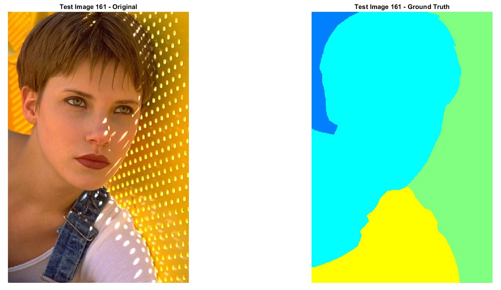
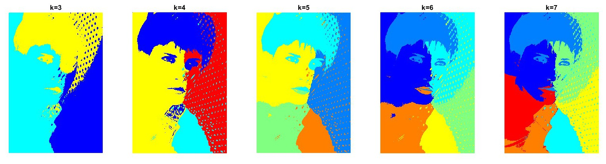
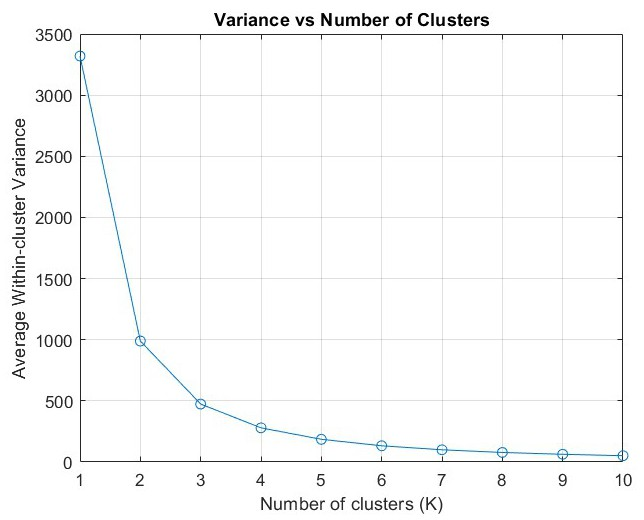
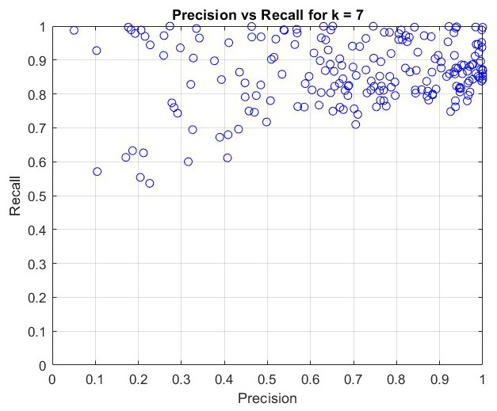

# K-means Image Segmentation on BSDS500

Unsupervised colour-and-position K-means segmentation of the Berkeley Segmentation Dataset
(BSDS500) test images in MATLAB, with an exploratory supervised pipeline based on SLIC
superpixels, Gabor features and logistic regression. Coursework for the module *Artificial
Intelligence for Autonomous Systems*, MSc Advanced Air Mobility Systems, Cranfield University
(January 2024).


<p align="center">
  
  <br>
  
  <br>
  <em>Test image 161 and its first human segmentation (top), and the K-means segmentations for
  k = 3 to 7 (bottom; colours are arbitrary cluster labels).</em>
</p>

## Task

The assignment, *Image Segmentation for Scene Learning*, asked for a segmentation method that
groups similar pixels as a pre-processing stage for object detection and tracking, keeping the
semantic content of the scene while reducing the dimensionality of the input. The method had
to be selected, implemented on the 200 test images of BSDS500 and assessed against the human
ground truth with metrics such as precision and recall.

## Method

**Unsupervised, the main approach** ([`src/kmeans_segmentation.m`](src/kmeans_segmentation.m)):

- every pixel is described by five features, (R, G, B, x, y), with the colours divided by 255
  and the coordinates by the image width and height;
- `kmeans` clusters them with k = 3 to 7 (3 replicates, up to 1,000 iterations), on all 200
  test images;
- the elbow method was tried to choose k, using the within-cluster variance for K = 1 to 10 and
  the within-cluster sum of squares for K = 3 to 20. The report found no clear elbow and kept
  k = 7;
- each segmentation is scored against the first human segmentation of the image with
  precision, recall and F1.

**Supervised, exploratory and unfinished** ([`src/slic_gabor_features.m`](src/slic_gabor_features.m),
[`src/supervised_logreg.m`](src/supervised_logreg.m)): SLIC superpixels (10 per image) and a Gabor
filter response give the mean colour and mean texture of every superpixel. Each pair of
superpixels is labelled "same segment" or not from the ground truth, and a logistic regression
is trained on the pair features. The scoring stage was never written.

## Results

Mean over the 200 test images. The report quotes k = 7; the re-run below executes the code in
this repository with MATLAB R2024b and `rng(0)` (K-means initialisation is random, so runs
without a fixed seed differ slightly).

| | k = 3 | k = 4 | k = 5 | k = 6 | k = 7 |
|---|---:|---:|---:|---:|---:|
| Precision, re-run | 0.703 | 0.694 | 0.693 | 0.687 | 0.688 |
| Recall, re-run | 0.675 | 0.752 | 0.801 | 0.823 | 0.853 |
| F1, re-run | 0.662 | 0.693 | 0.715 | 0.720 | **0.733** |
| Report (k = 7) | | | | | P 0.861, R 0.693, F1 **0.741** |

The F1 values agree within the run-to-run spread. The report's precision and recall match the
re-run's recall and precision respectively, so the two rows appear to have been swapped when the
report table was written; the precision-recall scatter plots used in the report
([`figures/kmeans`](figures/kmeans)) also show the high values on the recall axis.

| Elbow plot, within-cluster variance | Precision and recall per image, k = 7 |
|---|---|
|  |  |

## A note on the metric

`calculateMetrics` reduces both images to a binary mask, "label greater than 1": every pixel
outside K-means cluster 1 against every pixel outside ground-truth segment 1. K-means numbers its
clusters arbitrarily, so the two masks are not matched by content, and the score is not the
boundary-based BSDS benchmark described in the report's equations. Scoring trivial
segmentations with the same function shows how little the metric separates:

| Segmentation (first ground truth, 200 test images) | Precision | Recall | F1 |
|---|---:|---:|---:|
| K-means, k = 7 (re-run) | 0.688 | 0.853 | 0.733 |
| Random labels, 7 classes | 0.688 | 0.857 | 0.736 |
| Every pixel positive | 0.688 | 1.000 | 0.787 |

Precision stays near the share of pixels outside ground-truth segment 1 whatever the method, and
recall grows with k because a smaller share of pixels falls in cluster 1. The segmentations
themselves are visibly meaningful (figures above), but measuring their quality needs a metric
that is invariant to label numbering, such as the BSDS boundary F-measure, the Probabilistic Rand
Index, Variation of Information or segmentation covering, ideally over all human segmentations.

## Getting started

Requires MATLAB with the Statistics and Machine Learning Toolbox and the Image Processing
Toolbox (tested on R2024b). Download BSDS500 into `data/` as described in
[`data/README.md`](data/README.md), then from the repository root:

```matlab
addpath src
rng(0)                    % optional, makes the K-means numbers repeatable
kmeans_segmentation       % about 20 min: metrics table, precision-recall plots, three examples
run src/elbow_variance.m  % about 10 min
```

## Repository contents

| File | Report | Content |
|---|---|---|
| `src/kmeans_segmentation.m` | Appendix A-2 | K-means segmentation and scoring (originally `Unsupervised_KMeans.m`) |
| `src/elbow_variance.m` | Appendix A-1 | Elbow method, within-cluster variance, K = 1 to 10 (`Elbow.m`) |
| `src/elbow_wcss.m` | | Elbow method, within-cluster sum of squares, K = 3 to 20 (`Elbow_2.m`) |
| `src/slic_gabor_features.m` | Appendix A-3 | SLIC and Gabor feature extraction for the supervised approach (`SLIC_Gabor.m`) |
| `src/supervised_logreg.m` | | Logistic regression on superpixel pairs (`Supervised_LogReg.m`) |
| `src/pca_exploration.m` | | Whole-image PCA, explored but not used in the report (`PCA.m`) |
| `figures/` | | Figures of the report: elbow plots, K-means examples and precision-recall plots, SLIC and Gabor examples |
| `data/` | | Where BSDS500 goes (not included) |
| `docs/references.md` | | Bibliography of the report |

Only file paths changed in the code (and the PCA function name, which clashed with MATLAB's
`pca` on case-insensitive file systems). Known issues, left as written:

- `kmeans_segmentation.m` scores against the first human segmentation only, with the metric
  discussed above.
- `slic_gabor_features.m` builds the training pairs before the Gabor column is filled, so the
  training texture feature is always zero, and it reads the ground-truth label at pixel index
  *p* rather than for superpixel *p*. It writes the train, validation and test features to
  `results/`, then stops in `processGT`, which passes the ground-truth cell array to
  `superpixels`.
- `supervised_logreg.m` trains and predicts but never scores the predictions.
- The elbow scripts reshape each image to one column, so R, G and B values are clustered as
  separate one-dimensional points rather than as colour vectors.

## About the module

| | |
|---|---|
| Module | Artificial Intelligence for Autonomous Systems (AIAS) |
| Programme | MSc Advanced Air Mobility Systems, Cranfield University |
| Assignment | *Image Segmentation for Scene Learning*, individual report, 2023–24 |
| Lecturer | Dr I. Petrunin |

The report itself is not included in this repository; its bibliography is in
[`docs/references.md`](docs/references.md).

## License

The code is released under the [MIT License](LICENSE). The figures contain BSDS500 images,
which remain the property of their owners (see [`data/README.md`](data/README.md)).
